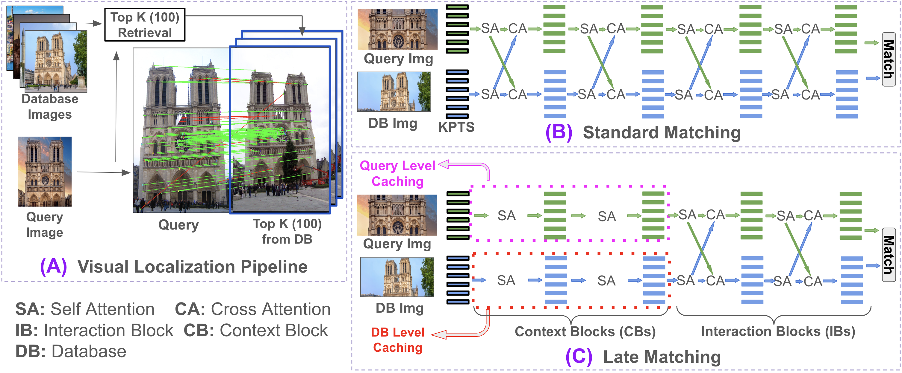

<h1 align="center">
  <a href="https://arxiv.org/abs/2610.25358"><ins>LateMatch</ins></a>
</h1>

<h3 align="center">
  Breaking the Interaction Bottleneck via Cacheable Matching
  <br>
  for Efficient Visual Localization
</h3>

<p align="center">
  Mohammad Omama
  &nbsp;&middot;&nbsp;
  Aeyan Ashraf
  &nbsp;&middot;&nbsp;
  Sandeep Chinchali
</p>

<p align="center">
  <a href="https://arxiv.org/abs/2610.25358"></a>
  
  <a href="./LICENSE"></a>
  
  
</p>

<p align="center">
    
    <br>
    <em>
    <b>Rethinking visual localization with cacheable image matching via LateMatch.</b>
    <b>(A)</b> Standard visual localization pipelines require matching a single query image against
    Top-K (e.g., K = 100) retrieved database images.
    <b>(B)</b> Traditional matching architectures interleave intra-image context building and
    inter-image cross-attention across all layers, preventing any caching and causing a severe
    computational bottleneck.
    <b>(C)</b> Our proposed LateMatch architecture breaks this bottleneck by deferring cross-image
    interaction to the final layers, decoupling the network into offline-cacheable Context Blocks
    (CBs) and online Interaction Blocks (IBs), reducing the effective compute cost by over 2&times;
    without sacrificing much on performance.
    </em>
</p>


## Install

```bash
git clone https://github.com/UTAustin-SwarmLab/LateMatch.git && cd LateMatch
python -m pip install -e .
```

Tested with Python 3.11, PyTorch 2.11 (CUDA 12.8), on Linux.


## Quickstart

```python
import torch
from latematch import LateGlue, SuperPoint, match_pair
from latematch.utils import load_image

device = "cuda" if torch.cuda.is_available() else "cpu"

extractor = SuperPoint(max_num_keypoints=2048).eval().to(device)
matcher = LateGlue(
    features="superpoint",
    n_context_blocks=5,      # cacheable: run once per image
    n_interaction_blocks=4,  # online: run once per pair
).eval().to(device)

image0 = load_image("path/to/image0.jpg").to(device)
image1 = load_image("path/to/image1.jpg").to(device)

feats0, feats1, matches01 = match_pair(extractor, matcher, image0, image1)
matches = matches01["matches"]  # (M, 2) indices into keypoints0 and keypoints1
points0 = feats0["keypoints"][matches[:, 0]]
points1 = feats1["keypoints"][matches[:, 1]]
```

### Model variants

`LateGlue` builds its stack as `n_context_blocks` context blocks (CBs) followed
by `n_interaction_blocks` interaction blocks (IBs). Only the IBs run per pair,
so the effective cost scales with `n_interaction_blocks` alone.

| Variant | `n_context_blocks` | `n_interaction_blocks` |
| --- | :---: | :---: |
| LightGlue-late1 … late4 | 5 | 1 … 4 |
| LightGlue-lite1 … lite4 | 0 | 1 … 4 |
| LightGlue (default) | 0 | 9 |

Pass a checkpoint with `LateGlue(..., weights="path/or/url")`, or call
`matcher.load_weights(...)` later. Context blocks are stored before interaction
blocks, so a shallower variant loads the matching prefix of a deeper
checkpoint and drops the rest.

To measure compute, disable the adaptive mechanisms so every block runs:
`LateGlue(..., depth_confidence=-1, width_confidence=-1)`.


## To Do
- [x] Push the LateGlue model code
- [ ] Push the LateMamba model code
- [ ] Push the E-SToRE code
- [ ] Push the Glue Factory integration instructions (training)
- [ ] Push the hloc integration instructions (SfM / visual localization)


## Citation
If LateMatch is useful for your research, please cite:
```bibtex
@inproceedings{omama2026latematch,
  title={{LateMatch: Breaking the Interaction Bottleneck via Cacheable Matching for Efficient Visual Localization}},
  author={Omama, Mohammad and
          Ashraf, Aeyan and
          Chinchali, Sandeep},
  booktitle={Conference on Robot Learning (CoRL)},
  year={2026}
}
```


## License
The LateMatch code in this repository is released under the [Apache-2.0 license](./LICENSE).
